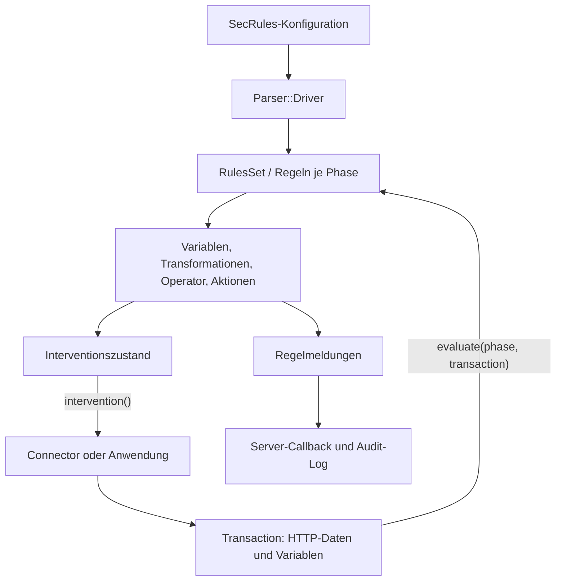

# ModSecurity v3: Architektur und Datenfluss

## Geltungsbereich

Diese Erklärung basiert auf `owasp-modsecurity/ModSecurity`, Branch `v3/master`, Commit **`effb6c0fa031a7bddb3253e0b7ab9ca9a18b5729`**. Alle nachfolgenden Quellenverweise sind auf diesen Commit festgelegt. Das Dokument beschreibt den untersuchten Quellcode; es belegt weder, ob eine bestimmte Installation erfolgreich gebaut wurde, noch welche optionalen Funktionen darin aktiviert sind oder ob ein externer Connector korrekt funktioniert.

Die wichtigsten Einstiegspunkte sind `headers/modsecurity/modsecurity.h`, `headers/modsecurity/rules_set.h`, `headers/modsecurity/transaction.h` und ihre Implementierungen in `src/`. Sprachmerkmale und Speicherbesitz behandelt [cpp-guide.md](cpp-guide.md).

## 1. Was dieses Projekt bereitstellt

Dieses Repository enthält **libmodsecurity**, die Bibliothek des ModSecurity-v3-Projekts. Die Bibliothek lädt Regeln in der SecRules-Sprache und verarbeitet HTTP-Daten, die eine Anwendung oder ein Connector bereitstellt. Die serverspezifische Integration liegt in separaten Connector-Projekten. Die Upstream-README nennt `ModSecurity-nginx` als ein Beispiel. Der Bibliotheksbuild erzeugt `libmodsecurity.la`. Quellen: [Umfang des Upstream-Projekts][scope], [Bibliotheksziel][lib-target].

Bei der Arbeit stellen sich daher drei getrennte Fragen: Welche Daten liefert der Connector? Welche Regeln und Einstellungen wurden geladen? Was macht die Bibliothek mit diesen Daten und Regeln? Ein Aufruf wie `processRequestHeaders()` liest die Header nicht selbst aus Nginx: Die Header werden zunächst durch `addRequestHeader()` in der Transaktion gespeichert. Der Beispielcode folgt genau dieser Reihenfolge. Quellen: [Header-Verarbeitung][request-headers], [beispielhafter Ablauf einer Connector-Anbindung][example-flow].

Die Bibliothek und eine konkrete Regelkonfiguration erfüllen unterschiedliche Aufgaben. `RulesSet::loadFromUri()` parst eine angegebene Datei; `modsecurity.conf-recommended` enthält unter anderem Engine-Einstellungen, Body-Einstellungen und Regeln zur Fehlerbehandlung. Diese Datei beginnt mit `SecRuleEngine DetectionOnly`. Das Vorhandensein einer `deny`-Regel belegt daher nicht, dass eine bestimmte Installation Anfragen aktiv blockiert: Der Code macht die Ausführung eingreifender Aktionen vom Engine-Zustand abhängig. Quellen: [Laden von Regeln][load], [empfohlene Konfiguration][recommended], [Ausführung von Aktionen][action-engine].

## 2. Die drei zentralen Objekte

| Objekt | Rolle im untersuchten Code | Wichtige Beziehungen |
| --- | --- | --- |
| `modsecurity::ModSecurity` | Initialisiert gemeinsam genutzte Collection-Backends und speichert Connector-Informationen sowie den Logging-Callback. | Stellt Collections bereit, die von Transaktionen verwendet werden. Konstruktor und Destruktor verwalten diese Backends. [Quelle][engine] |
| `modsecurity::RulesSet` | Lädt und vereinigt Regeln und Einstellungen; führt die Regeln einer Phase aus. | Erbt von `RulesSetProperties`, enthält `RulesSetPhases` und verwendet zum Laden `Parser::Driver`. [Header][rules-api], [Implementierung][load] |
| `modsecurity::Transaction` | Enthält den Zustand und die Daten einer HTTP-Transaktion: URI, Header, Bodys, Variablen, Regelmeldungen und Interventionszustand. | Erhält Zeiger auf `ModSecurity` und `RulesSet`; enthält transaktionsbezogene Collections und Body-Prozessoren. [Header][transaction-api], [Konstruktor/Destruktor][transaction-life] |

**Aus der Implementierung abgeleitete Lebensdauer:** `Transaction` speichert `m_ms` und `m_rules`, löscht diese Objekte aber nicht in seinem Destruktor. Die übergebenen Engine- und Ruleset-Objekte müssen daher gültig bleiben, solange die Transaktion sie verwendet. Das Beispiel mit stückweise übergebenen Bodys zerstört zuerst die Transaktion, dann das Ruleset und zuletzt die Engine. Eine zusätzliche automatische Übertragung des Besitzes an `Transaction` ist hier nicht implementiert. Quellen: [Konstruktor/Destruktor][transaction-life], [Freigabe im Beispiel][example-cleanup].

`Rules` und `RulesSet` sind unterschiedliche Typen. `Rules` enthält einen Vektor aus `std::shared_ptr<Rule>` und stellt unter anderem die Methoden `insert()`, `append()` und `at()` bereit. `RulesSet` ist der Einstiegspunkt für `loadFromUri()`, `load()` und `evaluate()`. Neue Erklärungen sollten sich an diesen tatsächlichen Headern orientieren. Quellen: [Rules][rules-bucket], [RulesSet][rules-api].

## 3. Wie aus Konfiguration ausführbare Regeln werden

`RulesSet::loadFromUri()` erzeugt einen `Parser::Driver`, lässt ihn die Datei parsen und übernimmt anschließend Regeln und Eigenschaften durch `merge()`. Bei einem auf diesem Pfad erkannten Parsefehler gibt die Methode `-1` zurück; bei Erfolg liefert sie eine Regelanzahl. Der Driver liest den Dateiinhalt, startet den Scanner und ruft `yy::seclang_parser::parse()` auf. Quellen: [Ladepfad von RulesSet][load], [Parsepfad des Drivers][driver-parse].

Der Driver ordnet Regeln ihren Phasen zu. Neue Regeln erhält er als `std::unique_ptr<RuleWithActions>`. Bei einer Kette überträgt er den Besitz an `m_chainedRuleChild`, das im Header als `std::shared_ptr<RuleWithActions>` deklariert ist; ein Zeiger ohne Besitz verweist auf das Elternobjekt. Einstiegsregeln außerhalb einer Kette werden ebenfalls in `std::shared_ptr` überführt und in die Phasensammlung eingefügt. An dieser Stelle prüft der Driver außerdem auf fehlende oder doppelte Regel-IDs und weist eingreifende Aktionen in nachfolgenden Kettengliedern zurück. Quellen: [Driver::addSecRule()][driver-rules], [Kettenfelder][chain-fields].

Das Diagramm fasst Aufrufe im Ladepfad, in `Transaction`, `RulesSet::evaluate()`, `RuleWithOperator::evaluate()` und im Logging zusammen. Es zeigt keine unabhängig laufenden Dienste. Quellen: [Laden][load], [Phasenausführung][rules-evaluate], [Regelausführung][rule-evaluate], [Intervention][intervention], [Logging][logging].

## 4. Lebenszyklus einer HTTP-Transaktion

Die folgende Tabelle fasst den üblichen vollständigen Ablauf zusammen, solange die Anwendung die Verarbeitung fortsetzt. Das Beispiel `examples/using_bodies_in_chunks/simple_request.cc` zeigt die API-Reihenfolge einschließlich wiederholter Interventionsprüfungen. Wie ein produktiver Connector nach einer Intervention die HTTP-Verarbeitung beendet oder umleitet, gehört zu dessen Implementierung. Quellen: [Beispiel, erste Hälfte][example-flow], [Beispiel, zweite Hälfte][example-cleanup].

| Schritt | C++-Einstiegspunkt | Verhalten der Implementierung |
| --- | --- | --- |
| 1. Verbindungsdaten übergeben | `processConnection(client, clientPort, server, serverPort)` | Setzt Verbindungsvariablen und führt `ConnectionPhase` aus. [Quelle][connection] |
| 2. Anfragezeile übergeben | `processURI(uri, method, httpVersion)` | Baut URI-, Methoden-, Protokoll- und Query-Variablen auf; extrahiert GET-Argumente. Ruft hier **nicht** `RulesSet::evaluate(UriPhase, …)` auf. [Quelle][uri] |
| 3. Anfrageheader sammeln | `addRequestHeader(...)` | Befüllt Header-Variablen, behandelt unter anderem Cookies und erkennt bestimmte Body-Typen. [Quelle][request-headers] |
| 4. Anfrageheader prüfen | `processRequestHeaders()` | Führt `RequestHeadersPhase` aus, sofern die Engine nicht deaktiviert ist. [Quelle][request-phase] |
| 5. Anfragebody sammeln | `appendRequestBody(buffer, length)` | Schreibt Bytes in `m_requestBody`; berücksichtigt beim Anhängen die Größenbegrenzung. [Quelle][request-append] |
| 6. Anfragebody prüfen | `processRequestBody()` | Verarbeitet Body-Formate und Fehlervariablen; führt `RequestBodyPhase` abhängig vom Engine-Zustand und Body-Zugriff aus. [Quelle][request-body] |
| 7. Antwortheader übergeben und prüfen | `addResponseHeader(...)`, `processResponseHeaders(status, protocol)` | Befüllt Antwortvariablen und führt `ResponseHeadersPhase` aus, sofern die Engine nicht deaktiviert ist. [Quelle][response-headers] |
| 8. Antwortbody sammeln und prüfen | `appendResponseBody(...)`, `processResponseBody()` | Berücksichtigt Größenbegrenzung, Zugriff auf den Antwortbody und konfigurierte MIME-Typen; führt gegebenenfalls `ResponseBodyPhase` aus. [Quelle][response-body] |
| 9. Logging abschließen | `processLogging()` | Kehrt bei deaktivierter Engine sofort zurück; führt andernfalls `LoggingPhase` aus und berücksichtigt das Speichern im Audit-Log, sofern eines vorhanden ist. [Quelle][logging] |
| 10. Ressourcen freigeben | Destruktor oder `msc_transaction_cleanup()` | Gibt Transaktionsressourcen frei; die API-Freigabe ruft `delete transaction` auf. [Destruktor][transaction-life], [C-Freigabe][c-cleanup] |

### Zwei unterschiedliche Nummerierungssysteme

Die Werte von `enum Phases` sind nicht mit den üblichen SecRules-Phasennummern identisch. Das Enum enthält zusätzlich `UriPhase`. `actions::Phase::init()` übersetzt die Phasenangabe einer Regel in den internen Wert. Quellen für die vollständige Zuordnung: [Enum][phases], [Übersetzung][phase-action].

| Interner Name | Interner Enum-Wert | SecRules-Angabe im untersuchten Code |
| --- | ---: | --- |
| `ConnectionPhase` | 0 | `phase:0` |
| `UriPhase` | 1 | Keine eigene Zuordnung in `Phase::init()`; `processURI()` befüllt Daten ohne diesen Aufruf zur Regelauswertung. |
| `RequestHeadersPhase` | 2 | `phase:1` |
| `RequestBodyPhase` | 3 | `phase:2`, Alias `request` |
| `ResponseHeadersPhase` | 4 | `phase:3` |
| `ResponseBodyPhase` | 5 | `phase:4`, Alias `response` |
| `LoggingPhase` | 6 | `phase:5`, Alias `logging` |

Kläre bei einer Zahl in Logs, Tests oder C++-Code, welches Nummerierungssystem sie verwendet. Auch der Header-Parametername `protocol` in `processURI()` reicht für sich allein nicht aus: Die Implementierung nennt den zweiten Parameter `method`, und Beispiele übergeben an dieser Stelle Werte wie `"GET"`. Quellen: [Header][transaction-api], [Implementierung][uri], [Beispiel][example-flow].

## 5. Was während der Regelauswertung passiert

`RulesSet::evaluate()` wählt zunächst die Regelsammlung für die übergebene interne Phase aus. Die Schleife berücksichtigt `allow`, `skip`, Marker sowie konfigurierte und transaktionsbezogene Ausnahmen. Nach der Ausführung einer Regel werden die Treffer-Variablen geleert. Sobald eine eingreifende Intervention gesetzt ist, beendet die Schleife die Auswertung der aktuellen Phase. Quelle: [RulesSet::evaluate()][rules-evaluate].

`RuleWithOperator::evaluate()` bestimmt die endgültigen Zielvariablen, lässt deren Werte auflösen, berücksichtigt ausgeschlossene Ziele und wendet Transformationen an. Anschließend prüft der Operator die entstandenen Werte. Ein Treffer ergänzt Trefferinformationen und Herkunftsangaben. Die Funktion unterscheidet Aktionen, die unabhängig vom Gesamtergebnis der Kette ausgeführt werden, von Aktionen, die nach einem vollständigen Kettentreffer ausgeführt werden. Die Behauptung, jede Aktion laufe erst nach dem Erfolg der gesamten Kette, wäre daher falsch. Quellen: [Regelauswertung][rule-evaluate], [unabhängige Aktionen und Aktionen nach vollständigem Kettentreffer][rule-actions].

Transformationen sind Teil des Vergleichspfads. `executeTransformations()` beginnt mit einer Kopie des Eingabewerts, berücksichtigt Standardaktionen und `t:none` und stellt mit `multiMatch` mehrere Vergleichszustände bereit. Daraus folgt nicht, dass die ursprüngliche HTTP-Nachricht im Webserver entsprechend umgeschrieben wird. Quellen: [Transformationen][transformations], [Operatoraufruf und Trefferverarbeitung][rule-evaluate].

Eine eingreifende Aktion wie `deny` setzt Status, Logtext und das Flag `disruptive` in der Transaktion. Die Entscheidung wird dem API-Aufrufer anschließend über `Transaction::intervention()` zugänglich gemacht. `RuleWithActions::executeAction()` führt eingreifende Aktionen nur bei `EnabledRuleEngine` aus. Quellen: [deny][deny], [Engine-Prüfung][action-engine], [Intervention][intervention].

## 6. Anfrage- und Antwortbodys

### Auswahl des Anfrageprozessors

Die Header-Verarbeitung erkennt Multipart- und URL-kodierte Typen anhand von `Content-Type`. JSON und XML werden über `ctl:requestBodyProcessor=JSON` oder `XML` ausgewählt: Die Aktionsklassen setzen `m_requestBodyProcessor`. `modsecurity.conf-recommended` enthält entsprechende Regeln für Phase 1. Quellen: [Header-Erkennung][request-type], [JSON-Aktion][json-selection], [XML-Aktion][xml-selection], [Konfigurationsregeln][recommended].

| Body-Pfad | Verarbeitung in `processRequestBody()` | Bedingung oder Ergebnis |
| --- | --- | --- |
| URL-kodiert | `extractArguments("POST", ...)` | Verwendet `m_requestBodyType == WWWFormUrlEncoded`; berücksichtigt die Begrenzung ohne Dateien. |
| Multipart | Lokales `Multipart`-Objekt mit `init()`, `process()`, `multipart_complete()` | Übernimmt Parserfehler und die Größe der Daten ohne Dateien. |
| JSON | `m_json->init()`, `processChunk()`, `complete()` | Unter `WITH_YAJL`; berücksichtigt gegebenenfalls die konfigurierte JSON-Tiefenbegrenzung. |
| XML | `m_xml->init()`, `processChunk()`, `complete()` | Unter `WITH_LIBXML2`. |

Quelle für diese Tabelle: [vollständiger Anfragebody-Pfad][request-body]. Die Variablen `REQBODY_ERROR`, `REQBODY_PROCESSOR_ERROR` und zugehörige Meldungen werden im Parsepfad gesetzt. Die Beispielkonfiguration enthält Regeln, die diese Fehler auswerten. Ein gesetztes Fehlerflag bedeutet nicht, dass der Webserver die Anfrage bereits blockiert hat. Quellen: [Body-Pfad][request-body], [Fehlerregeln der Konfiguration][recommended-errors].

### Pufferung, Prüfung und Begrenzungen

`appendRequestBody()` und `appendResponseBody()` nehmen einzelne Datenstücke entgegen, schreiben diese aber in den jeweiligen Stream. `processRequestBody()` greift später auf `m_requestBody.str()` zu. Die Chunk-API belegt daher nicht, dass jede SecRule sofort auf jedes neue Netzwerkpaket angewendet wird. Quellen: [Anhängen von Anfragedaten][request-append], [Anfrageauswertung][request-body], [Antwortverarbeitung][response-body].

Größenbegrenzungen können bereits beim Anhängen greifen. Der Zweig `ProcessPartial` schreibt nur die verbleibende Kapazität und gibt `false` zurück. Im Ablehnungszweig kann eine Intervention mit Status 403 gesetzt werden, obwohl die Append-Methode weiterhin `true` zurückgibt. Für eine korrekte Integration müssen daher der Rückgabewert **und** die Interventionsprüfung getrennt behandelt werden. Quellen: [Anfragebegrenzung][request-append], [Antwortbegrenzung][response-body].

Die genaue Position einer Prüfung ist entscheidend: In `processRequestBody()` steht die Engine-Prüfung zuerst, danach folgt die Formatverarbeitung; die Prüfung von `SecRequestBodyAccess` oder seiner transaktionsbezogenen Überschreibung erfolgt weiter unten vor der Regelphase. Auch die Antwortauswertung prüft den Zugriff auf den Antwortbody und die MIME-Auswahl vor `ResponseBodyPhase`. Diese Beschreibung darf nicht zu einer allgemeinen Behauptung über die Pufferungsreihenfolge eines externen Connectors erweitert werden. Quellen: [Anfragebody][request-body], [Antwortbody][response-body].

## 7. Interventionen verstehen

`ModSecurityIntervention` enthält `status`, `pause`, `url`, `log` und `disruptive`. Im untersuchten Code liefert `Transaction::intervention()` den eingreifenden Zustand zurück. Im aktiven Zweig kopiert die Methode URL und Logtext mit `strdup`, überträgt Status und das Flag für den eingreifenden Zustand, markiert die Transaktion als unterbrochen und setzt den internen Interventionszustand zurück. Ein wiederholter Aufruf liefert daher nicht garantiert dasselbe Ergebnis. Quellen: [Struktur und Hilfsfunktionen][intervention-type], [Implementierung][intervention].

Für den Aufrufer ist dies eine Handlungsaufforderung. Die Bibliothek setzt an dieser Stelle keinen HTTP-Status im Webserver. Das Beispiel mit stückweise übergebenen Bodys prüft den Rückgabewert und zeigt den Status oder die Umleitung an; die Wirkung im Produktivbetrieb muss im Connector geprüft werden. Der C-Einstiegspunkt `msc_intervention_cleanup()` gibt die kopierten Puffer frei und initialisiert die Struktur neu. Quellen: [Hilfsfunktion im Beispiel][example-intervention], [C-Freigabe][c-cleanup].

**Konkrete Abweichung zwischen Kommentar und Code:** Der Kommentar zu `intervention()` verspricht bei Erfolg initialisierte Felder. Der Funktionskörper weist `pause` jedoch keinen Wert zu. Die vollständige Initialisierung der Struktur ist deshalb eine begründete Vorsichtsmaßnahme für neu geschriebenen aufrufenden Code. Diese Beobachtung stammt aus der Quellcodeprüfung, nicht aus einem ausgeführten Fehlertest. Quellen: [Kommentar und Implementierung][intervention], [Struktur][intervention-type].

## 8. Variablen, Collections und Logs

Anfrage- und Antworteigenschaften werden in Variablen gespeichert, die an die Transaktion gebunden sind. `VariableValue` enthält Collection, Schlüssel, Wert und Herkunftsangaben; die Regelauswertung verwendet diese Angaben unter anderem für Trefferreferenzen. Das erklärt, warum Änderungen an der Dekodierung oder an Offsets neben Vergleichswerten auch die Diagnoseausgabe beeinflussen können. Quellen: [VariableValue][variable-value], [Trefferauswertung][rule-evaluate], [URI-Verarbeitung][uri].

`ModSecurity` erzeugt die Backends für `GLOBAL`, `RESOURCE`, `IP`, `SESSION` und `USER`. Mit `WITH_LMDB` verwendet dieser Konstruktor LMDB; andernfalls verwendet er `InMemoryPerProcess`. `collection::Collections` erhält Zeiger auf diese Backends und erzeugt zusätzlich ein eigenes In-Memory-Backend für `TX`, das sein Destruktor löscht. Persistenz darf daher nicht für jede Collection und jeden Build versprochen werden. Quellen: [Engine-Backends][engine], [Transaktions-Collections][collections].

Es gibt mehrere getrennte Logging-Pfade. `Transaction::debug()` leitet über das Ruleset an das Debug-Log weiter. `ModSecurity::serverLog()` ruft den konfigurierten Callback mit Text oder einer `RuleMessage` auf. Bei deaktivierter Engine kehrt `processLogging()` vor der Logging-Phase und der Audit-Auswahl zurück. Andernfalls wertet die Methode Phase 5 aus und ruft, falls `m_auditLog` vorhanden ist, dessen `AuditLog::saveIfRelevant()` auf; diese Methode berücksichtigt unter anderem Audit-Status, Relevanz und Writer. Ein Callback-Ereignis allein belegt daher nicht, dass ein Audit-Datensatz geschrieben wurde. Quellen: [Debug-Weiterleitung][transaction-debug], [Server-Callback][callback], [Logging-Phase][logging], [Audit-Auswahl][audit].

## 9. Grenzen dieser Architekturübersicht

Diese Übersicht beschreibt den zentralen Ablauf und seine belegten Verzweigungen. Bei einer Änderung ersetzt sie weder das Lesen der betroffenen Operator-, Aktions- und Variablenimplementierungen noch die Ausführung der relevanten Regressionstests. Sie gibt keine Garantien für alle möglichen Eingaben, Thread-Sicherheit, externe Connector-Versionen oder die Wirksamkeit eines geladenen Rulesets. Diese Punkte müssen für die konkrete Aufgabe geprüft und bei fehlenden Belegen als ungeklärt festgehalten werden.

Besondere Stolperfallen für neue Chats sind veraltete API-Namen in einigen Kommentarbeispielen, die beiden Phasennummerierungen, die Unterscheidung zwischen einem Regeltreffer und einer Intervention sowie die unterschiedlichen Bedeutungen von Chunk-Eingabe und Regelauswertung. Die oben verlinkten Implementierungen liefern die passenden Einstiegspunkte.

[scope]: https://github.com/owasp-modsecurity/ModSecurity/blob/effb6c0fa031a7bddb3253e0b7ab9ca9a18b5729/README.md#L21-L46
[lib-target]: https://github.com/owasp-modsecurity/ModSecurity/blob/effb6c0fa031a7bddb3253e0b7ab9ca9a18b5729/src/Makefile.am#L1-L14
[engine]: https://github.com/owasp-modsecurity/ModSecurity/blob/effb6c0fa031a7bddb3253e0b7ab9ca9a18b5729/src/modsecurity.cc#L62-L109
[rules-api]: https://github.com/owasp-modsecurity/ModSecurity/blob/effb6c0fa031a7bddb3253e0b7ab9ca9a18b5729/headers/modsecurity/rules_set.h#L49-L107
[transaction-api]: https://github.com/owasp-modsecurity/ModSecurity/blob/effb6c0fa031a7bddb3253e0b7ab9ca9a18b5729/headers/modsecurity/transaction.h#L335-L419
[transaction-life]: https://github.com/owasp-modsecurity/ModSecurity/blob/effb6c0fa031a7bddb3253e0b7ab9ca9a18b5729/src/transaction.cc#L113-L182
[rules-bucket]: https://github.com/owasp-modsecurity/ModSecurity/blob/effb6c0fa031a7bddb3253e0b7ab9ca9a18b5729/headers/modsecurity/rules.h#L41-L87
[load]: https://github.com/owasp-modsecurity/ModSecurity/blob/effb6c0fa031a7bddb3253e0b7ab9ca9a18b5729/src/rules_set.cc#L50-L109
[driver-parse]: https://github.com/owasp-modsecurity/ModSecurity/blob/effb6c0fa031a7bddb3253e0b7ab9ca9a18b5729/src/parser/driver.cc#L128-L198
[driver-rules]: https://github.com/owasp-modsecurity/ModSecurity/blob/effb6c0fa031a7bddb3253e0b7ab9ca9a18b5729/src/parser/driver.cc#L76-L124
[chain-fields]: https://github.com/owasp-modsecurity/ModSecurity/blob/effb6c0fa031a7bddb3253e0b7ab9ca9a18b5729/headers/modsecurity/rule_with_actions.h#L106-L109
[rules-evaluate]: https://github.com/owasp-modsecurity/ModSecurity/blob/effb6c0fa031a7bddb3253e0b7ab9ca9a18b5729/src/rules_set.cc#L121-L232
[rule-evaluate]: https://github.com/owasp-modsecurity/ModSecurity/blob/effb6c0fa031a7bddb3253e0b7ab9ca9a18b5729/src/rule_with_operator.cc#L199-L353
[rule-actions]: https://github.com/owasp-modsecurity/ModSecurity/blob/effb6c0fa031a7bddb3253e0b7ab9ca9a18b5729/src/rule_with_actions.cc#L202-L295
[transformations]: https://github.com/owasp-modsecurity/ModSecurity/blob/effb6c0fa031a7bddb3253e0b7ab9ca9a18b5729/src/rule_with_actions.cc#L327-L441
[action-engine]: https://github.com/owasp-modsecurity/ModSecurity/blob/effb6c0fa031a7bddb3253e0b7ab9ca9a18b5729/src/rule_with_actions.cc#L299-L324
[deny]: https://github.com/owasp-modsecurity/ModSecurity/blob/effb6c0fa031a7bddb3253e0b7ab9ca9a18b5729/src/actions/disruptive/deny.cc#L31-L45
[phases]: https://github.com/owasp-modsecurity/ModSecurity/blob/effb6c0fa031a7bddb3253e0b7ab9ca9a18b5729/headers/modsecurity/modsecurity.h#L97-L170
[phase-action]: https://github.com/owasp-modsecurity/ModSecurity/blob/effb6c0fa031a7bddb3253e0b7ab9ca9a18b5729/src/actions/phase.cc#L25-L72
[connection]: https://github.com/owasp-modsecurity/ModSecurity/blob/effb6c0fa031a7bddb3253e0b7ab9ca9a18b5729/src/transaction.cc#L227-L250
[uri]: https://github.com/owasp-modsecurity/ModSecurity/blob/effb6c0fa031a7bddb3253e0b7ab9ca9a18b5729/src/transaction.cc#L337-L443
[request-headers]: https://github.com/owasp-modsecurity/ModSecurity/blob/effb6c0fa031a7bddb3253e0b7ab9ca9a18b5729/src/transaction.cc#L492-L598
[request-type]: https://github.com/owasp-modsecurity/ModSecurity/blob/effb6c0fa031a7bddb3253e0b7ab9ca9a18b5729/src/transaction.cc#L576-L589
[request-phase]: https://github.com/owasp-modsecurity/ModSecurity/blob/effb6c0fa031a7bddb3253e0b7ab9ca9a18b5729/src/transaction.cc#L461-L471
[request-body]: https://github.com/owasp-modsecurity/ModSecurity/blob/effb6c0fa031a7bddb3253e0b7ab9ca9a18b5729/src/transaction.cc#L674-L871
[request-append]: https://github.com/owasp-modsecurity/ModSecurity/blob/effb6c0fa031a7bddb3253e0b7ab9ca9a18b5729/src/transaction.cc#L929-L971
[response-headers]: https://github.com/owasp-modsecurity/ModSecurity/blob/effb6c0fa031a7bddb3253e0b7ab9ca9a18b5729/src/transaction.cc#L992-L1097
[response-body]: https://github.com/owasp-modsecurity/ModSecurity/blob/effb6c0fa031a7bddb3253e0b7ab9ca9a18b5729/src/transaction.cc#L1117-L1230
[logging]: https://github.com/owasp-modsecurity/ModSecurity/blob/effb6c0fa031a7bddb3253e0b7ab9ca9a18b5729/src/transaction.cc#L1304-L1346
[intervention]: https://github.com/owasp-modsecurity/ModSecurity/blob/effb6c0fa031a7bddb3253e0b7ab9ca9a18b5729/src/transaction.cc#L1350-L1389
[intervention-type]: https://github.com/owasp-modsecurity/ModSecurity/blob/effb6c0fa031a7bddb3253e0b7ab9ca9a18b5729/headers/modsecurity/intervention.h#L23-L62
[c-cleanup]: https://github.com/owasp-modsecurity/ModSecurity/blob/effb6c0fa031a7bddb3253e0b7ab9ca9a18b5729/src/transaction.cc#L2153-L2195
[json-selection]: https://github.com/owasp-modsecurity/ModSecurity/blob/effb6c0fa031a7bddb3253e0b7ab9ca9a18b5729/src/actions/ctl/request_body_processor_json.cc#L28-L35
[xml-selection]: https://github.com/owasp-modsecurity/ModSecurity/blob/effb6c0fa031a7bddb3253e0b7ab9ca9a18b5729/src/actions/ctl/request_body_processor_xml.cc#L28-L35
[recommended]: https://github.com/owasp-modsecurity/ModSecurity/blob/effb6c0fa031a7bddb3253e0b7ab9ca9a18b5729/modsecurity.conf-recommended#L1-L37
[recommended-errors]: https://github.com/owasp-modsecurity/ModSecurity/blob/effb6c0fa031a7bddb3253e0b7ab9ca9a18b5729/modsecurity.conf-recommended#L64-L98
[example-flow]: https://github.com/owasp-modsecurity/ModSecurity/blob/effb6c0fa031a7bddb3253e0b7ab9ca9a18b5729/examples/using_bodies_in_chunks/simple_request.cc#L147-L226
[example-cleanup]: https://github.com/owasp-modsecurity/ModSecurity/blob/effb6c0fa031a7bddb3253e0b7ab9ca9a18b5729/examples/using_bodies_in_chunks/simple_request.cc#L225-L282
[example-intervention]: https://github.com/owasp-modsecurity/ModSecurity/blob/effb6c0fa031a7bddb3253e0b7ab9ca9a18b5729/examples/using_bodies_in_chunks/simple_request.cc#L95-L129
[variable-value]: https://github.com/owasp-modsecurity/ModSecurity/blob/effb6c0fa031a7bddb3253e0b7ab9ca9a18b5729/headers/modsecurity/variable_value.h#L38-L125
[collections]: https://github.com/owasp-modsecurity/ModSecurity/blob/effb6c0fa031a7bddb3253e0b7ab9ca9a18b5729/src/collection/collections.cc#L37-L56
[transaction-debug]: https://github.com/owasp-modsecurity/ModSecurity/blob/effb6c0fa031a7bddb3253e0b7ab9ca9a18b5729/src/transaction.cc#L196-L204
[callback]: https://github.com/owasp-modsecurity/ModSecurity/blob/effb6c0fa031a7bddb3253e0b7ab9ca9a18b5729/src/modsecurity.cc#L193-L212
[audit]: https://github.com/owasp-modsecurity/ModSecurity/blob/effb6c0fa031a7bddb3253e0b7ab9ca9a18b5729/src/audit_log/audit_log.cc#L278-L325
